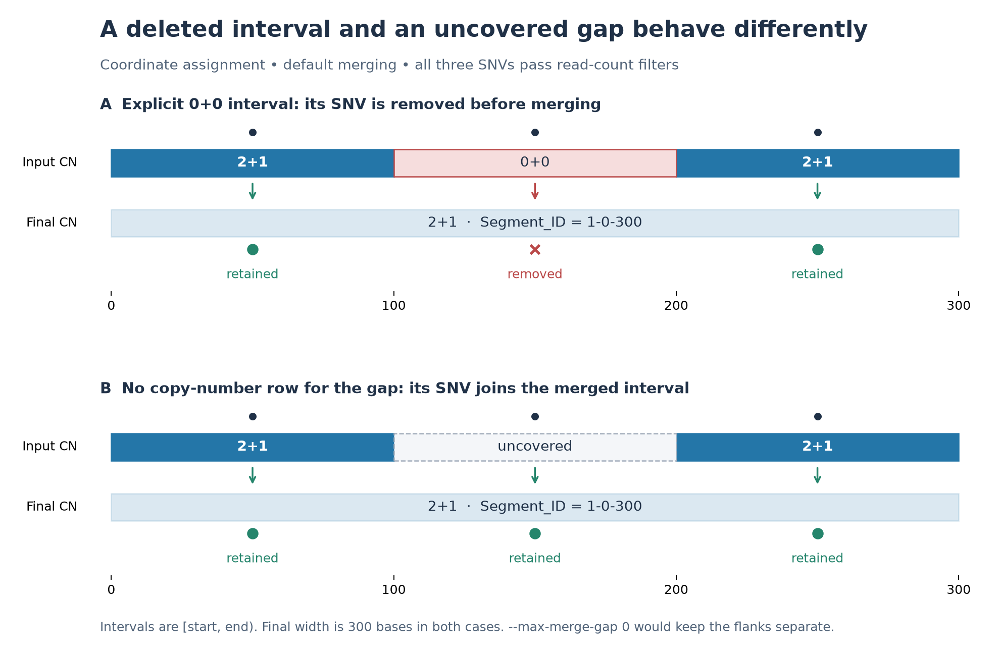
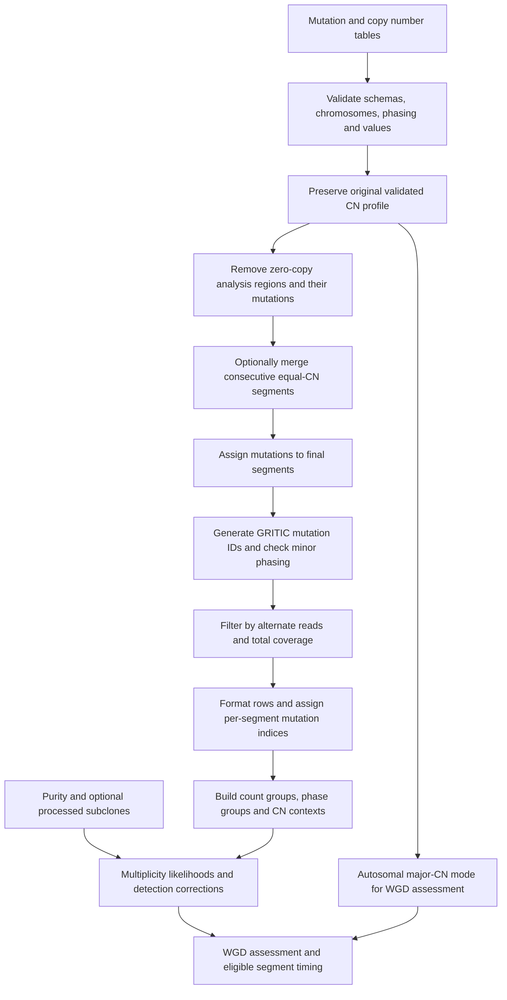
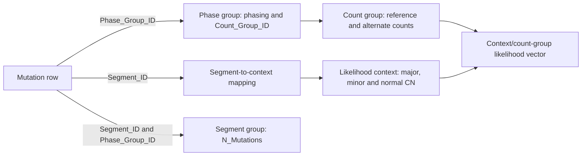
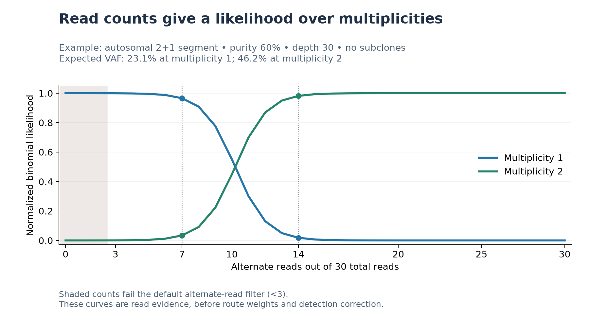

# GRITIC

GRITIC estimates the timing and route histories of clonal copy number gains from single-sample bulk whole-genome sequencing of cancer genomes. It supports complex allele-specific copy-number states and up to one whole-genome duplication (WGD); see [timing eligibility](#timing-eligibility).

Gain timing is measured in mutation time, from 0 near conception to 1 at the emergence of the tumour's most recent common ancestor.

GRITIC is agnostic to reference genome. The number of numbered autosomes is configurable, and both X/Y and Z/W sex-chromosome systems are supported.

The method is described in [Baker et al. (2024), *The History of Chromosomal Instability in Genome-Doubled Tumors*][publication].

## Table of contents

- [Installation](#installation)
- [Quick start](#quick-start)
- [Input tables](#input-tables)
  - [Mutation table](#mutation-table)
  - [Copy number table](#copy-number-table)
  - [Subclone table](#subclone-table)
- [Input processing](#input-processing)
  - [Preparation order](#preparation-order)
  - [Grouping retained mutations](#grouping-retained-mutations)
- [Run options](#run-options)
  - [Required run arguments](#required-run-arguments)
  - [Output handling](#output-handling)
  - [Genome and input handling](#genome-and-input-handling)
  - [Mutation filtering and detection correction](#mutation-filtering-and-detection-correction)
  - [Subclone handling](#subclone-handling)
  - [Inference model and WGD calling](#inference-model-and-wgd-calling)
  - [Timing intervals](#timing-intervals)
- [Outputs](#outputs)
  - [Posterior timing summaries](#posterior-timing-summaries)
  - [`_route_table.tsv`](#_route_tabletsv)
  - [`_route_tree_table.tsv`](#_route_tree_tabletsv)
  - [`_gain_timing_table.tsv`](#_gain_timing_tabletsv)
  - [`_wgd_calling_info.json`](#_wgd_calling_infojson)
  - [`_gain_timing_table_wgd_segments.tsv`](#_gain_timing_table_wgd_segmentstsv)
  - [Processed inputs and downstream tables](#processed-inputs-and-downstream-tables)
- [Model details](#model-details)
  - [Balanced route priors](#balanced-route-priors)
  - [Balanced WGD segments](#balanced-wgd-segments)
  - [WGD timing estimation](#wgd-timing-estimation)
  - [Multiplicity likelihoods](#multiplicity-likelihoods)
  - [Detection correction and mutation-share priors](#detection-correction-and-mutation-share-priors)
  - [Posterior sampling](#posterior-sampling)
- [Downstream formats](#downstream-formats)
  - [`_count_group_table.tsv`](#_count_group_tabletsv)
  - [`_phase_group_table.tsv`](#_phase_group_tabletsv)
  - [`_likelihood_context_table.tsv`](#_likelihood_context_tabletsv)
  - [`_segment_context_table.tsv`](#_segment_context_tabletsv)
  - [`_count_group_likelihood_table.tsv`](#_count_group_likelihood_tabletsv)
  - [`_segment_group_table.tsv`](#_segment_group_tabletsv)
  - [Timing archives](#timing-archives)
- [Python API](#python-api)
  - [Running GRITIC](#running-gritic)
  - [Input handling](#input-handling)
  - [Timing intervals and WGD inference](#timing-intervals-and-wgd-inference)
  - [Reading timing archives](#reading-timing-archives)

## Installation

Python 3.12 or newer is required. Install the version documented here from this repository checkout:

```bash
python -m pip install .
```

## Quick start

Run this example from the repository root. It writes directly to `examples/output/TEST_ID`, which must not already exist, even if empty. To reuse it, supply `--overwrite`.

```bash
gritic \
    --mutation-table examples/snv_table_example.tsv \
    --copy-number-table examples/cn_table_example.tsv \
    --subclone-table examples/subclone_table_example.tsv \
    --purity 0.5 \
    --sample-id TEST_ID \
    --sample-dir examples/output/TEST_ID \
    --wgd-count 1 \
    --random-seed 20260828
```

Use `gritic --help` for command-line help or see [run options](#run-options). For programmatic use, see [Python API](#python-api).

GRITIC writes inference tables and posterior archives. Use [PLOTIC](../plotic/README.md)
to visualize these outputs, including evolutionary route trees.

## Input tables

Supply tab-separated copy-number and mutation tables, plus an optional subclone table. Inputs from any caller are accepted if they follow these schemas; see [`examples/`](examples/).

Column names are case-sensitive. Additional caller-supplied columns are accepted, but only the canonical mutation fields described below are retained after formatting. See [input processing](#input-processing) for the order of validation, filtering, segment assignment, and likelihood construction.

### Mutation table

All SNVs for the sample, with either `Mutation_ID` or `Position` required alongside the three mandatory columns below.

| Column | Requirement | Values |
| --- | --- | --- |
| `Chromosome` | Required | Labels following the [chromosome-handling rules](#chromosome-handling). |
| `Tumor_Ref_Count` | Required | Number of reads supporting the reference allele. |
| `Tumor_Alt_Count` | Required | Number of reads supporting the alternate allele. |
| `Mutation_ID` | Required unless `Position` is supplied | Literal text, preserving values such as `000123`, `NA`, and `NULL`. |
| `Position` | Required unless `Mutation_ID` is supplied | Zero-based genomic position. |
| `Segment_ID` | Optional | Enables supplied-ID assignment when also present in the copy number table. |
| `Phasing` | Optional | `major` or `minor`, case-insensitive, ignoring surrounding whitespace. Missing values remain unphased. |
| `Context` | Optional | Retained annotation; not used in the gain-timing read likelihood. |

Supplying `--drop-unrecognized-phasing` drops mutations with unrecognized phasing and reports the number dropped and the unrecognized values.

Input mutation columns named `Segment_Start`, `Segment_End`, `Major_CN`, or `Minor_CN` are ignored because GRITIC always annotates those values from the copy-number table.

GRITIC selects the segment-assignment mode from the columns present in the two tables:

| Behavior | Supplied-ID mode | Coordinate mode |
| --- | --- | --- |
| Selected when | Both tables contain `Segment_ID`. | Otherwise, including when only one table contains `Segment_ID`. |
| Assignment | Input segment ID maps to its final segment after the selected merge behavior. | Same chromosome and `Segment_Start <= Position < Segment_End` in the final analysis spans. |
| Use of `Position` | Not needed for assignment. If supplied, validated numerically but not checked against the named interval. | Required and used for assignment. |
| `Source_Segment_ID` | Original input segment ID. | Final assigned coordinate-derived segment ID. |
| Mutation-identity uniqueness scope | Original input segment. | Final assigned segment. |

In supplied-ID mode, both tables require nonblank `Segment_ID` values, and those IDs must be unique in the copy-number table. Every mutation's `Segment_ID` must match a copy-number row, including its `Chromosome`. If `--drop-unmatched-snvs` is supplied, GRITIC drops mutations unmatched by either assignment mode and reports the number dropped. Missing or blank supplied IDs and chromosome mismatches remain errors.

GRITIC drops zero-copy `0+0` segments and their mutations before merging. GRITIC
warns when dropping these mutations, independently of `--drop-unmatched-snvs`.

The selected `Mutation_ID` or canonical integer `Position` value must be nonblank and unique within the scope shown above. An explicit `Mutation_ID` column takes precedence for every row; GRITIC does not fall back to `Position` for blank values in that column. The same selected value may be reused in different source segments. With supplied segment IDs, this also applies to source segments that GRITIC subsequently merges. In coordinate mode, repeated identities in the same final merged segment are rejected.

### Copy number table

The rounded allele-specific copy-number profile for the sample requires `Chromosome`, `Segment_Start`, `Segment_End`, `Major_CN`, and `Minor_CN`. Chromosome labels follow the [rules below](#chromosome-handling). Segments use zero-based, half-open intervals. Intervals on the same chromosome must not overlap. Supplied `Segment_ID` values enable the assignment mode described under [Mutation table](#mutation-table).

#### Timing eligibility

The supported allele-specific copy-number states are:

| `Major_CN` | Permitted `Minor_CN` |
| --- | --- |
| 1–5 | 0 through `Major_CN` |
| 6 | 0–4 |
| 7 | 0–3 |
| 8 | 0–1 |

The `1+0` and `1+1` states use uniform no-gain timing. In WGD runs, major-copy-number-two segments are excluded from the ordinary per-segment fit. [WGD timing estimation](#wgd-timing-estimation) uses those on configured autosomes with at least 10 retained SNVs. Balanced `2+2` segments use a [WGD-specific allele model](#balanced-wgd-segments).

Input validation and timing eligibility are separate: a valid positive-CN segment can be retained in the analysis profile even when its state is outside these fitting limits. Only segments with retained mutations become model `Segment` objects. Ordinary per-segment fitting has no hard 10-mutation minimum; 10 is the WGD-candidate cutoff and a recommendation for interpreting gained segments.

#### Segment merging

By default, GRITIC merges consecutive segments on the same chromosome having identical `Major_CN` and `Minor_CN`. The merged interval runs from the first segment's start through the last segment's end, including any intervening uncovered bases. Use `--max-merge-gap` to limit gaps or `--keep-adjacent-segments` to preserve input segments. Final segment IDs are generated from `Chromosome`, `Segment_Start`, and `Segment_End` after merging.

Removing zero-copy intervals can make equal-copy-number segments consecutive, so `2+1 → 0+0 → 2+1` becomes one `2+1` segment by default. The gap limit includes the removed interval. Mutations assigned to original zero-copy intervals remain excluded even when a merged interval spans them; in coordinate mode, mutations in other uncovered gaps follow the merged interval's coordinates. Merged lengths include intervening bases. GRITIC preserves the original validated copy-number profile for WGD copy-number-mode calculations.



In both examples the final span is `1-0-300`, but the middle mutation is removed only when the original profile explicitly assigns it to `0+0`. Setting `--max-merge-gap 0` keeps the flanking intervals separate in both examples. A positive-CN interval with a different state remains a merge barrier even if it has no retained mutations or its state is ineligible for timing.

#### Chromosome handling

Both input tables accept numbered chromosomes from 1 through `--autosome-count` and the sex chromosomes present under the selected karyotype. Chromosome labels are case-sensitive; one leading lowercase `chr` prefix is removed, without other spelling or case normalization.

| Karyotype | Present sex chromosomes | Normal X or Z copies | Normal Y or W copies |
| --- | --- | --- | --- |
| XX | X | 2 | 0 |
| XY | X, Y | 1 | 1 |
| ZZ | Z | 2 | 0 |
| ZW | Z, W | 1 | 1 |

When sample sex is not supplied, GRITIC infers it from the copy-number table: Y implies `XY` and W implies `ZW`; otherwise X alone implies XX and Z alone implies ZZ. If no sex chromosome is represented, GRITIC defaults to `XX`, so callers using another system should supply `--sample-sex`. Mixing X/Y and Z/W labels prevents automatic sex inference. Inference happens before chromosome filtering. Chromosomes outside the configured set follow `--drop-unmatched-chromosomes` behavior.

### Subclone table

The optional subclone table gives the identified subclonal peaks and their assigned mutation fractions for the sample.

Required columns are:

- `Cluster`: the subclone identifier.
- `Subclone_CCF`: cancer cell fraction. CCF determines the expected VAF of a subclone state.
- `Subclone_Fraction`: the fraction of input SNVs assigned to the subclone. Mutation shares determine its mixture prior.

Candidates are filtered using the [subclone-handling options](#subclone-handling). If no subclones remain, GRITIC uses its clonal-only model. If there are more than two subclones, GRITIC groups them into two: the subclone with the largest CCF is unmodified and the remaining clones are combined by summing their fractions and taking their fraction-weighted mean CCF.

Retained `Subclone_Fraction` values keep their input scale; the remaining share is treated as clonal.

## Input processing

GRITIC converts the paired tables into segment-specific, weighted likelihoods over mutation multiplicity. The CLI follows `load_input_tables` → `Sample` → `prepare_sample_inputs`, then builds the model inputs and calls `process_sample`. The Python `Sample` API enters the same preparation path with DataFrames, without the TSV-reading step.



The original validated CN profile (`sample.cn_table`) retains original boundaries and zero-copy intervals for the width-weighted autosomal major-CN mode, regardless of whether those intervals have retained mutations. The analysis profile (`sample.copy_number_table`) removes zero-copy intervals and may contain merged spans. Final positive-CN spans without retained mutations remain in the analysis profile but do not become model `Segment` objects or receive likelihood contexts. Positive-CN segments with mutations are grouped before timing eligibility is applied.

### Preparation order

The order below matters: a malformed mutation can fail validation even if its read counts would later cause it to be discarded.

1. **Read and check the schemas.** The TSV reader preserves identifiers and integer-valued fields as text before numeric validation, avoiding loss of leading zeros in IDs or precision in large coordinates. The paired headers select supplied-ID or coordinate assignment. Mutation identity uses `Mutation_ID` whenever that column exists, otherwise `Position`.
2. **Resolve sex and chromosomes.** Infer or validate the karyotype, remove the optional `chr` prefix, then validate chromosome labels in both tables. With `--drop-unmatched-chromosomes`, unsupported rows are dropped with warnings. Empty inputs after chromosome filtering are errors.
3. **Normalize mutation phasing.** Strip surrounding whitespace and lowercase labels. Missing values remain unphased. Unrecognized non-missing labels cause an error unless `--drop-unrecognized-phasing` is enabled. A literal whitespace-only value is not a recognized label; an empty TSV field normally reads as missing.
4. **Validate CN intervals and values.** Coordinates must be finite nonnegative signed-64-bit integers with `Segment_End > Segment_Start`. Sort intervals in genomic order and reject overlaps, including overlapping equal-CN intervals. Touching intervals are allowed. Copy numbers must be finite integers with `0 <= Minor_CN <= Major_CN`; GRITIC does not round fractional estimates or swap inverted major/minor values.
5. **Validate mutation values and identity.** Read counts must be finite nonnegative signed-64-bit integers; their sum must be positive and fit signed 64-bit. If `Position` is present, every value must be a finite nonnegative signed-64-bit integer, including in supplied-ID mode. The selected mutation identity must be nonblank.
6. **Validate supplied segment IDs, when used.** Check nonblank IDs, unique CN IDs, and chromosome agreement. Check mutation-identity uniqueness within each input segment before dropping unknown-ID or zero-copy mutations. Unknown IDs cause an error or are dropped with `--drop-unmatched-snvs`; missing IDs and chromosome mismatches remain errors.
7. **Remove zero-copy regions from analysis.** Resolve mutation ownership against the original profile, using IDs in supplied-ID mode or original half-open intervals in coordinate mode. Drop these mutations with a warning, independently of `--drop-unmatched-snvs`, and remove `0+0` rows from the analysis CN profile.
8. **Apply the selected segment-merging behavior.** Merge consecutive equal-CN intervals unless disabled, respecting `--max-merge-gap` when supplied. Generate final `Chromosome-Start-End` segment IDs even when merging is disabled; retain an input-to-final ID map in supplied-ID mode. See [segment merging](#segment-merging).
9. **Assign mutations and generate GRITIC IDs.** Map supplied IDs or match coordinates to final analysis spans, then attach CN annotations. Unmatched coordinates cause an error or are dropped with `--drop-unmatched-snvs`. In coordinate mode, check mutation-identity uniqueness within each final assigned segment. Form `GRITIC_Mutation_ID` from URL-escaped `Source_Segment_ID`, a colon, and the URL-escaped selected mutation identity.
10. **Validate phasing against assigned CN.** A mutation marked `minor` in a segment with `Minor_CN=0` is an error. This check occurs before read filtering.
11. **Filter reads and format the retained rows.** Keep mutations satisfying both `Tumor_Alt_Count >= 3` and `Tumor_Ref_Count + Tumor_Alt_Count >= 10` by default; both thresholds are configurable and inclusive. Empty retained mutation sets are errors. Fill absent optional canonical columns with missing values and assign dense zero-based `Segment_Mutation_Index` values by sorting `GRITIC_Mutation_ID` lexically within each final segment. These indices are not genomic-position ranks.

The read filter also warns when the minimum alternate-read count before filtering is greater than 10, because the upstream mutation caller's threshold may differ from GRITIC's detection assumption. The temporary total-read-count column is not retained in the canonical mutation table.

After paired-input preparation, `Sample` validates and filters the optional [subclone table](#subclone-table), reduces excess subclones, and derives `N_SNVs` from the retained mutation count. It then constructs the grouping tables and segment likelihoods. The implementation is in [`dataloader.py`](gritic/dataloader.py) and [`sampletools.py`](gritic/sampletools.py).

### Grouping retained mutations

GRITIC retains each mutation's identity while sharing repeated likelihood calculations through sample-wide dictionaries:

| Table | One row represents |
| --- | --- |
| [Count group](#_count_group_tabletsv) | A distinct `(Tumor_Ref_Count, Tumor_Alt_Count)` pair. |
| [Phase group](#_phase_group_tabletsv) | A distinct `(Count_Group_ID, Phasing)` pair; missing phasing becomes `non_phased` here. |
| [Segment group](#_segment_group_tabletsv) | A `(Segment_ID, Phase_Group_ID)` pair and its `N_Mutations` weight. |
| [Likelihood context](#_likelihood_context_tabletsv) | A distinct `(Major_CN, Minor_CN, Normal_Total_CN)` triple. |
| [Segment context](#_segment_context_tabletsv) | A final segment's likelihood-context ID. |
| [Count-group likelihood](#_count_group_likelihood_tabletsv) | A state-likelihood vector for each context/count-group pair actually observed. |

Dictionary IDs are zero-based, consecutive, and deterministic. Count groups sort by reference then alternate count; phase groups sort by count group, then `non_phased`, `major`, `minor`; contexts sort by the three CN fields. Equal VAF alone does not define a count group: 3 alternate reads out of 10 and 30 out of 100 provide different read evidence. Group counts retain every mutation's statistical weight.

`Normal_Total_CN` is 2 on autosomes and follows the [karyotype-specific rules](#chromosome-handling) on sex chromosomes. An autosome and a sex chromosome with one normal copy require different likelihood contexts even if their tumour CN states agree. Coordinates and mutation identifiers determine assignment and provenance; [multiplicity likelihoods](#multiplicity-likelihoods) use read counts, purity, CN, and any retained subclone CCFs.

## Run options

### Required run arguments

- `--mutation-table` A path to the [mutation table](#mutation-table) for the sample.
- `--copy-number-table` A path to the [copy-number table](#copy-number-table) for the sample.
- `--purity` The estimated cellular purity for the sample.
- `--sample-id` Sample ID used as an output filename prefix. It must be a cross-platform-safe filename component.
- `--sample-dir` Sample output directory.

### Output handling

- `--overwrite` Reuse the existing `--sample-dir` directory and its subdirectories. Files with the same names as new outputs are overwritten; all other files are preserved.

### Genome and input handling

- `--autosome-count` Number of numbered autosomes in the organism (default: 22). This defines the accepted numbered chromosome labels and the chromosomes eligible for WGD inference.
- `--sample-sex` Override the inferred karyotype with `XX`, `XY`, `ZZ`, or `ZW`. See [chromosome handling](#chromosome-handling) for inference rules and normal copy numbers.
- `--drop-unmatched-chromosomes` Drop copy-number and mutation rows whose chromosome is not one of the configured autosomes or present sex chromosomes and report the number of rows dropped. By default, any such chromosome is an error.
- `--drop-unmatched-snvs` Drop mutation rows that cannot be associated with a copy-number segment by either supplied `Segment_ID` or genomic `Position` and report the number dropped. By default, unmatched mutations raise an error.
- `--drop-unrecognized-phasing` Drop mutation rows whose non-missing `Phasing` value is not `major` or `minor` and report the number dropped. By default, unrecognized phasing labels raise an error.
- `--keep-adjacent-segments` Preserve input copy-number segments separately. See [segment merging](#segment-merging) for the default behavior.
- `--max-merge-gap N` Merge consecutive equal-copy-number segments only when the gap is at most `N` bases. If omitted, there is no maximum; use `0` to merge only intervals that touch.

### Mutation filtering and detection correction

- `--min-mutation-alt-count` Minimum `Tumor_Alt_Count` needed to retain a mutation (default: 3).
- `--min-mutation-coverage` Minimum `Tumor_Ref_Count + Tumor_Alt_Count` needed to retain a mutation (default: 10).
- `--coverage-vaf-quantile` Observed-SNV VAF quantile used to select mutations for the mean-coverage estimate in the detection correction (default: 0.9). See [detection correction and mutation-share priors](#detection-correction-and-mutation-share-priors).

### Subclone handling

- `--subclone-table` A path to the [subclone table](#subclone-table) for the sample. If omitted, GRITIC assumes every SNV is clonal, which can bias gain timings earlier.
- `--clip-subclone-ccf` Clip out-of-range `Subclone_CCF` values before filtering. With the default CCF filters, values clipped to either boundary are subsequently excluded.
- `--min-subclone-ccf` Minimum `Subclone_CCF` retained as a subclone, inclusive (default: 0.01).
- `--max-subclone-ccf` Maximum `Subclone_CCF` retained as a subclone, inclusive (default: 0.9).
- `--min-subclone-fraction` A subclone's normalized share of the subclonal mutation fractions after CCF filtering must be strictly greater than this threshold (default: 0.1).
- `--subclone-fraction-prior {adjusted,supplied}` Use detection-adjusted mutation fractions or the supplied fractions in the mutation-share prior (default: `adjusted`). See [detection correction and mutation-share priors](#detection-correction-and-mutation-share-priors).

The value of `--min-subclone-ccf` must be greater than 0.

### Inference model and WGD calling

Every run requires configured autosomal segments with a segment-width-weighted modal `Major_CN` of 1 or 2, including runs with a supplied WGD count.

- `--wgd-count {0,1}` Override GRITIC's inferred WGD count. If omitted, GRITIC infers the count. GRITIC warns when the supplied count conflicts with modal major copy number. See [WGD timing estimation](#wgd-timing-estimation).
- `--random-seed` Seed stochastic inference with an unsigned 64-bit integer. If omitted, GRITIC generates a random seed using sources provided by the operating system.
- `--unordered-balanced-route-prior` Use a uniform prior over unordered allele-route pairs. See [balanced route priors](#balanced-route-priors) for the weighting of ordered routes.

### Timing intervals

Intervals default to highest posterior density (HPD, `hpd`); `equal-tailed` is also available. Interval widths specify probability mass.

| Interval family | Options | Default width | Controls |
| --- | --- | --- | --- |
| Route gain | `--route-gain-interval-width`, `--route-gain-interval-method` | 0.95 | Route-conditional gain bounds in both gain timing tables and route-conditioned node/WGD bounds in the topology table. |
| WGD overlap | `--wgd-overlap-interval-width`, `--wgd-overlap-interval-method` | 0.9 | Internal candidate-segment bounds that determine WGD overlap and can change WGD inference. |
| Sample WGD | `--wgd-timing-interval-width`, `--wgd-timing-interval-method` | 0.9 | Final sample-level WGD bounds shared by the calling-info JSON, route table, and no-gain routes in the topology table. |
| Posterior summary | `--posterior-summary-interval-width`, `--posterior-summary-interval-method` | 0.95 | Gain and gain-conditioned WGD bounds in posterior summaries. |

## Outputs

Append each suffix below to `SAMPLE_ID`. We recommend only considering gained segments with 10 or more SNVs. `process_sample` writes the processed mutation, grouping, context, likelihood, and subclone tables before timing inference. Presence in a processed-input table does not imply that a segment received a timing fit; see [timing eligibility](#timing-eligibility).

| File or directory suffix | Contents |
| --- | --- |
| [`_posterior_timing_table_summary_penalty_*.tsv`](#posterior-timing-summaries) | Main gain-timing summaries, with ordinary and penalized route weights. |
| [`_route_table.tsv`](#_route_tabletsv) | Route probabilities and segment metadata. |
| [`_route_tree_table.tsv`](#_route_tree_tabletsv) | Explicit route topology and route-conditioned event timing for PLOTIC. |
| [`_gain_timing_table.tsv`](#_gain_timing_tabletsv) | Gain-node timing conditional on each route. |
| [`_wgd_calling_info.json`](#_wgd_calling_infojson) | Sample WGD call and timing. |
| [`_gain_timing_table_wgd_segments.tsv`](#_gain_timing_table_wgd_segmentstsv) | Preliminary segment timings used to evaluate WGD. |
| [`_mutation_table.tsv`](#_mutation_tabletsv) | Processed mutations and downstream identifiers. |
| [`_count_group_table.tsv`](#_count_group_tabletsv) | Distinct read-count pairs. |
| [`_phase_group_table.tsv`](#_phase_group_tabletsv) | Read-count groups subdivided by phasing. |
| [`_likelihood_context_table.tsv`](#_likelihood_context_tabletsv) | Distinct copy-number observation contexts. |
| [`_segment_context_table.tsv`](#_segment_context_tabletsv) | Segment-to-context mapping. |
| [`_count_group_likelihood_table.tsv`](#_count_group_likelihood_tabletsv) | Multiplicity likelihoods by count group and context. |
| [`_segment_group_table.tsv`](#_segment_group_tabletsv) | Mutation counts by segment and phase group. |
| [`_subclone_table.tsv`](#_subclone_tabletsv) | Processed subclone inputs. |
| [`_timing_dicts`](#timing-archives) | Posterior archives for downstream mutation timing. |

### Posterior timing summaries

`_posterior_timing_table_summary_penalty_<True|False>.tsv` summarizes independent-gain timing across routes, keyed by (`Sample_ID`, `Segment_ID`, `Gain_Index`). `Gain_Index` is a 1-based chronological index of independent gains.

| Result columns | Interpretation |
| --- | --- |
| `Timing_Median`, `Timing_Low_CI`, `Timing_High_CI` | Gain-timing median and configured posterior-summary interval. |
| `Proportion` | Fraction of posterior route draws in which this independent gain exists. |
| `WGD_Timing_Median`, `WGD_Timing_Low_CI`, `WGD_Timing_High_CI` | WGD-timing median and interval. |
| `Pre_WGD_Probability`, `Post_WGD_Probability` | Probabilities of the gain preceding or following WGD. |

Only gains with `Proportion >= 0.8` are reported. Its denominator includes all route draws for the segment, including routes with no independent gains.

Gain and WGD statistics on a row use the same subset of draws in which that gain exists. WGD-related fields are blank in non-WGD runs. Segment coordinates, copy numbers, mutation count, mutation rate, and WGD status accompany these results.

`_penalty_False.tsv` uses `Probability`; `_penalty_True.tsv` uses a separate set of draws with `Penalized_Probability`. See [posterior sampling](#posterior-sampling) for how these draws are constructed.

### _route_table.tsv

This table contains one row for each possible route of each timed segment, keyed by `(Sample_ID, Segment_ID, Route)`. Routes with no independently timeable gains are retained here.

`Timing_Representation` is `Route_Particles` for ordinary gained routes and `Uniform_No_Gain` when every extant copy spans the `[0,1]` interval. The table stores ordinary `Probability` and post-hoc `Penalized_Probability`, average event and loss counts, a timing-space sampling-density diagnostic (`Density`), runtime (`Time`), and segment and WGD metadata.

`Route` is an order-sensitive identifier of the complete allele route. See [posterior sampling](#posterior-sampling) for the density diagnostic.

`Penalized_Probability` is calculated by multiplying each route's ordinary probability by `exp(-2.7 * Average_N_Events)` and renormalizing across routes within the segment. Tree output uses ordinary probabilities. See [Baker et al. (2024)][publication] for details of the penalty.

### _route_tree_table.tsv

This table exports the surviving-copy ancestry for every reported route, keyed
by (`Sample_ID`, `Segment_ID`, `Route`, `Node`). `Parent_Node` is blank for an
allele root and otherwise identifies its parent within that route.
`Node_Phasing` is `Major` or `Minor`, and `WGD_Symbol` identifies a WGD event.
The topology contains the surviving branches used by inference; it does not
add hypothetical lost descendants.

`Timing`, `Timing_CI_Low`, and `Timing_CI_High` summarize each node's
route-conditioned event time. Terminal copies have time 1. The repeated
`Route_WGD_Timing`, `Route_WGD_Timing_CI_Low`, and
`Route_WGD_Timing_CI_High` fields summarize that route's WGD particles and are
blank for non-WGD routes. `Route_WGD_Source` identifies `Route_Posterior`, or
`Sample_Posterior` for uniform no-gain routes that have no route-specific WGD
draws. Non-WGD rows leave this source blank. Route-posterior summaries use the
configured route-gain interval and preserve the route's chronological
ordering; WGD values can differ from sample-level WGD summaries. No-gain
routes instead retain the sample WGD summary and its configured interval.

The table is always written during timing inference. PLOTIC's
`plotic route-tree SAMPLE_DIR --segment-id SEGMENT_ID -o route.svg` command
uses it with the route table. Earlier output directories without this table
must be regenerated with GRITIC to use the new renderer.

### _gain_timing_table.tsv

This table contains one row per independently timeable gain node per route and is keyed by four identifier columns: (`Sample`, `Segment`, `Route`, `Node`).

The remaining columns are `Node_Phasing`, `Timing` (the median), and `Timing_CI_Low` and `Timing_CI_High` (the configured route-gain interval). Timing statistics are conditional on the route.

`Node_Phasing` is `Major` or `Minor`; a route with one extant allele component labels every node `Major`.

### _wgd_calling_info.json

Keys are `WGD_Timing`, `WGD_Timing_CI_Low`, `WGD_Timing_CI_High`, `Major_CN_Mode`, `Overlap_Proportion`, `WGD_Status`, and `Best_Overlap_Timing`; missing or nonfinite numeric values are `null`.

See [WGD timing estimation](#wgd-timing-estimation) for eligibility, the overlap decision, and the final timing estimate.

### _gain_timing_table_wgd_segments.tsv

This table is produced while evaluating WGD timing. It gives the preliminary non-WGD node posterior for every eligible major-copy-number-two segment. Displayed `Timing_CI_Low` and `Timing_CI_High` use the route-gain interval. `Intersecting`, `Best_Overlap_Timing`, and `Overlap_Proportion` use the separate, unrounded internal WGD-overlap intervals. Displayed bounds therefore need not determine `Intersecting`; see [timing intervals](#timing-intervals) for the settings.

### Processed inputs and downstream tables

#### _mutation_table.tsv

The processed mutation table, including identifiers used by downstream mutation timing. `Segment_ID` is GRITIC's final coordinate-derived segment ID after the selected merge behavior.

Every output row contains these mutation identity, mapping, and provenance columns:

- `Source_Segment_ID` is the input segment ID when both input tables supplied matching `Segment_ID` columns. For position-based copy-number assignment it is the final assigned segment ID.
- `Mutation_ID` contains the literal input `Mutation_ID` when supplied and is blank otherwise.
- `Position` contains the canonical input position when supplied and is blank otherwise.
- `GRITIC_Mutation_ID` is the canonical sample-unique identifier formed by joining the URL-escaped source segment and selected mutation identity with a colon. The identity is `Mutation_ID` when supplied, otherwise canonical `Position`.
- `Segment_Mutation_Index` is a zero-based, consecutive index within the final `Segment_ID`, assigned by lexical `GRITIC_Mutation_ID` order.
- `Phase_Group_ID` links the mutation to one row of [`_phase_group_table.tsv`](#_phase_group_tabletsv). Together with `Segment_ID`, it also links to the mutation count in [`_segment_group_table.tsv`](#_segment_group_tabletsv).

Use `GRITIC_Mutation_ID` for downstream mutation joins.

Follow `Phase_Group_ID` through the [phase](#_phase_group_tabletsv) and [count](#_count_group_tabletsv) dictionaries to recover phasing and read counts. Follow `Segment_ID` through [`_segment_context_table.tsv`](#_segment_context_tabletsv) and [`_likelihood_context_table.tsv`](#_likelihood_context_tabletsv) to recover `Major_CN`, `Minor_CN`, and total copy number.



The exported mutation TSV retains coordinates and `Context`, but omits repeated read counts, phasing, CN values, and likelihood vectors. Those values reside in the linked tables above.

#### _subclone_table.tsv

The retained and processed subclone inputs with the fixed columns `Cluster`, `Subclone_CCF`, `Subclone_Fraction`, and `N_SNVs`. This file is always written. If no subclone table was supplied, or no candidate survived filtering, it contains the header and zero rows.

GRITIC derives `N_SNVs` from the retained mutation count and each retained/combined `Subclone_Fraction`, overwriting an input `N_SNVs` column.

## Model details

### Balanced route priors

For an allele-balanced `N+N` state, GRITIC defaults to a uniform prior over the ordered Cartesian product of single-allele histories, conditional on the copy-number and WGD setting.

With `--unordered-balanced-route-prior`, an `A/A` route retains weight 1 and each orientation of an `A/B` pair receives weight 0.5, so the pair carries the same total prior weight as `A/A`.

Without phased SNVs, reciprocal routes have equal likelihoods and probabilities. With phased SNVs, GRITIC evaluates their likelihoods and posteriors separately before applying the selected prior.

### Balanced WGD segments

When evaluating a possible WGD or pooling timing for a called WGD, GRITIC constrains the two homolog histories and timings of an original balanced `2+2` segment to be identical. It retains mutation `Phasing` labels but evaluates every SNV against one representative duplicated allele. The likelihood context retains the original `2+2` copy number, while timing uses a single pseudo-`2+0` route. If WGD is rejected, the ordinary independent-route `2+2` model uses mutation phasing.

See [timing archives](#timing-archives) for the pooled-WGD encoding.

### WGD timing estimation

GRITIC calculates the modal `Major_CN`, weighted by segment width, across the configured autosomes. With automatic WGD inference, mode 1 gives a WGD count of 0. Mode 2 triggers timing of autosomal major-copy-number-two segments with at least 10 retained SNVs; at least one must produce a finite timing interval.

`Best_Overlap_Timing` is the mutation-time point covered by the greatest total segment width across the candidate segments' internal WGD-overlap intervals. `Overlap_Proportion` is that covered width divided by the total width of eligible segments with finite intervals. An overlap of at least 60% gives an inferred WGD count of 1; a lower overlap gives 0 and emits a warning.

Overlapping segments are pooled and refit by minor-copy-number class, and their timing densities are combined into 500 sample-level draws. For a WGD call, `WGD_Timing` and its interval fields summarize those draws using the configured sample-WGD interval.

### Multiplicity likelihoods

For a mutation read-count group, let $a$ be the alternate count and $n$ the total depth. Let $\rho$ be cellular purity, $M$ and $m$ the tumour major and minor copy numbers, and $C_N$ the normal total copy number. The expected variant allele fraction (VAF) for state $s$ is:

$$
p_s = \min\left(1,\frac{\rho s}{\rho(M+m)+(1-\rho)C_N}\right).
$$

Clonal states have $s=1,\ldots,M$. Each retained subclone adds a state with $s$ equal to its CCF, representing a single mutant copy in that fraction of cancer cells. GRITIC evaluates a binomial read likelihood and normalizes it across the candidate states:

$$
b_{gs}=\Pr(a_g\mid n_g,p_s),\qquad
L_{gs}=\frac{b_{gs}}{\sum_j b_{gj}}.
$$

The implementation evaluates log probabilities and subtracts their maximum before exponentiation for numerical stability. The exported `Prob_Mult_*` and `Prob_Subclone_*` columns contain these normalized read likelihoods; route histories and mixture weights enter later during timing inference.



For the illustrated autosomal `2+1` segment at purity 0.6, expected VAF is approximately 0.231 for multiplicity one and 0.462 for multiplicity two. At depth 30, 7 alternate reads give normalized likelihoods of approximately 0.966 and 0.034; 14 alternate reads give 0.018 and 0.982. No subclones are included in this example.

Unphased and major-phased observations use clonal multiplicities `1..Major_CN`. Minor-phased observations select only `1..Minor_CN` and renormalize the retained likelihood columns. Subclone columns are included in each applicable phase category. The route model supplies mixture weights for each category, and their log-likelihood contributions are added. Shared count-group likelihoods therefore preserve both phasing information and mutation frequencies.

The calculation and phase-specific state selection are implemented in [`sampletools.py`](gritic/sampletools.py).

### Detection correction and mutation-share priors

Detection correction is enabled by default. Within each segment, GRITIC calculates the `--coverage-vaf-quantile` quantile of retained observed-SNV VAFs (default 0.9), then averages coverage over SNVs with VAF strictly greater than that quantile minus 0.01. Both operations account for the number of mutations represented by each count group.

Let $\overline{D}$ be that mean depth and $A_{\min}$ the configured minimum alternate-read count. Poisson thinning gives the detection probability for state $s$:

$$
d_s=\Pr\!\left[\operatorname{Poisson}(\overline{D}p_s)\geq A_{\min}\right].
$$

This corrects for the alternate-read threshold. The minimum-total-coverage threshold controls which observations are retained, but it is not an additional condition in this detection probability; the code does not explicitly model the joint selection event.

For underlying mixture weights $w_s$ proposed by a route/timing model, GRITIC uses detection-adjusted observation weights $w'_s$. Within each applicable phasing category, the grouped log likelihood is:

$$
w'_s=\frac{w_s d_s}{\sum_j w_j d_j},\qquad
\log\mathcal{L}=\sum_g N_g\log\left(\sum_s w'_s L_{gs}\right),
$$

where $N_g$ is the number of mutations represented by group $g$. This retains the likelihood contribution of every mutation while calculating repeated read evidence once. The Python API can disable reads correction with `apply_reads_correction=False`, which uses correction factors of one; the CLI uses the default enabled correction.

GRITIC fits clonal and subclonal mutation shares using these read likelihoods. The clonal input fraction is one minus the sum of the retained subclonal fractions. The supplied subclone CCFs determine expected VAFs; mutation fractions inform a weak Dirichlet prior rather than assigning individual mutations to clusters in advance.

With `--subclone-fraction-prior adjusted`, GRITIC divides the clonal and subclonal input fractions by their estimated detection probabilities separately for each segment, then renormalizes them. The clonal fraction uses the multiplicity-one detection probability. With `supplied`, it uses the fractions directly. Dirichlet parameters are one plus the resulting fractions. Both modes apply the segment-specific detection correction in the likelihood. The coverage quantile affects that likelihood correction in both modes and the prior adjustment only in `adjusted` mode.

The `supplied` prior follows [Baker et al. (2024)][publication], Supplementary Methods §8.3.4, equation 22. The publication's detection correction averages detection power over individual SNV depths (§8.3.5, equation 23); the current implementation uses the mean-coverage approach above.

### Posterior sampling

GRITIC retains 1,000 likelihood-resampled particles for each sampled route. The `Density` diagnostic reports the fraction of tested timing points with another sampled point within the sampling neighborhood. It covers hit-and-run timing coordinates. Analytic uniform routes require no chain and report density 1.

Current outputs do not support calculating R-hat. The saved particles have
been resampled with replacement according to likelihood, and do not retain
chronological chain identities or iterations. Neither arbitrary particle
blocks nor different evolutionary routes can serve as comparable chains.
`Density` is a coverage diagnostic, not R-hat. Supporting R-hat would require
new inference diagnostics or ordered independent chains for a common target
retained before pooling and resampling; the current hit-and-run sampler
explores proposal geometry rather than directly sampling the posterior.

Each posterior-summary draw samples a route and its gain and WGD timings jointly, preserving dependence between events. The [gain timing table](#_gain_timing_tabletsv) supplies node identity and phasing metadata; the [timing archives](#timing-archives) contain the joint timing draws and route weights used for downstream inference.

## Downstream formats

`Count_Group_ID`, `Phase_Group_ID`, and `Likelihood_Context_ID` are sample-wide, zero-based, consecutive identifiers.

### _count_group_table.tsv

One row per distinct `(Tumor_Ref_Count, Tumor_Alt_Count)` pair in the retained sample, with columns `Sample_ID`, `Count_Group_ID`, `Tumor_Ref_Count`, and `Tumor_Alt_Count`.

### _phase_group_table.tsv

Count groups subdivided by mutation phasing, with columns `Sample_ID`, `Phase_Group_ID`, `Count_Group_ID`, and `Phasing`. Phasing values are `non_phased`, `major`, or `minor`; `Count_Group_ID` references [`_count_group_table.tsv`](#_count_group_tabletsv).

### _likelihood_context_table.tsv

One row per distinct read-count observation context, with columns `Sample_ID`, `Likelihood_Context_ID`, `Major_CN`, `Minor_CN`, and `Normal_Total_CN` (normal total copy number).

### _segment_context_table.tsv

Each final segment with retained mutations mapped to one observation context, with columns `Sample_ID`, `Segment_ID`, and `Likelihood_Context_ID`.

### _count_group_likelihood_table.tsv

One likelihood vector per `(Likelihood_Context_ID, Count_Group_ID)` pair used by at least one segment. The fixed leading columns are `Sample_ID`, `Likelihood_Context_ID`, and `Count_Group_ID`, followed by `Prob_Mult_1`, `Prob_Mult_2`, and so on through the largest sample-wide major copy number, then `Prob_Subclone_0`, `Prob_Subclone_1`, and so on. Multiplicity columns above the row context's `Major_CN` are blank. Applicable entries sum to one per row.

### _segment_group_table.tsv

Columns `Sample_ID`, `Segment_ID`, `Phase_Group_ID`, and `N_Mutations`, keyed by (`Segment_ID`, `Phase_Group_ID`). `N_Mutations` counts retained mutations in the segment belonging to that phase group.

### Timing archives

The `_timing_dicts` directory contains compressed posterior archives for mutation timing.

`Route_Particles` segments store gain timing and multiplicity particles. A `Uniform_No_Gain` segment writes no store when it has no subclones; with subclones it writes only the fitted clone-share posterior. Each archive consists of two files:

- `SEGMENT_ID_timing_dict.npz`
- `SEGMENT_ID_timing_dict.manifest.json`

Pooled WGD stores use the same pair with a `WGD_minor_cn_N` identifier in place of `SEGMENT_ID`. See [Reading timing archives](#reading-timing-archives) for a Python example.

The rows of `Timing`, `WGD_Timing`, and `Mult` are aligned; use the same row index for one joint posterior draw.

A subclonal `Uniform_No_Gain` route contains only `Clone_Share`, whose columns contain fitted mutation shares for the clonal cluster followed by each subclone.

<details>
<summary>Archive schema</summary>

Each `Route_Particles` entry contains the following numeric arrays:

- `Probability` and `Penalized_Probability` are one-element float64 arrays containing the route weights used for downstream inference.
- `Timing` is a float64 `N_Particles x N_Timing_Nodes` matrix. `Timing_Node_ID` is the aligned int64 identifier for each column, corresponding to `Node` in the [gain timing table](#_gain_timing_tabletsv).
- `WGD_Timing` is the aligned float64 WGD vector and `Mult` is the aligned float64 multiplicity matrix. Non-WGD models use an all-NaN `WGD_Timing` vector; WGD models use finite values.
- `Interval_Start_Source`, `Interval_End_Source`, `Interval_Multiplicity`, and `Interval_Phasing` describe every mutation-bearing route interval without requiring the consumer to reconstruct a route tree. Source 0 is constant zero, source 1 is constant one, source 2 is `WGD_Timing`, and source `3+j` is column `j` of `Timing`. Phasing is a bit mask: 1 is `non_phased`, 2 is `major`, and 4 is `minor`.
- `State_Column_Offsets` and `State_Columns` map phasings onto `Mult` columns. The four offsets delimit three slices in `non_phased`, `major`, `minor` order. `Mult` contains the corresponding unphased, major-phased, and minor-phased multiplicity blocks followed by shared subclone columns, which occur at the tail of every applicable slice.
- `Target_Major_CN`, `Target_Minor_CN`, and `Target_WGD_Status` describe the genomic segment to which inference applies. `Model_Major_CN`, `Model_Minor_CN`, and `Model_WGD_Status` describe the fitted particle geometry. `N_Subclones` gives the shared number of subclone columns.
- `Archive_Kind` is 0 for an ordinary segment store and 1 for a pooled-WGD store. For pooled `2+2` segments, target metadata describe `2+2` with WGD and model metadata describe `2+0` without WGD. Phasing masks and state slices address the representative major allele; see the [balanced WGD model](#balanced-wgd-segments).

</details>

## Python API

### Running GRITIC

Run this example from the repository root. It writes directly to `examples/output/TEST_ID`. Pass `overwrite=True` to `gritictimer.process_sample` to reuse an existing sample directory; files with matching names are overwritten and other files are preserved.

```python
import pandas as pd

from gritic import dataloader, gritictimer, sampletools

copy_number_table, mutation_table = dataloader.load_input_tables(
    'examples/cn_table_example.tsv',
    'examples/snv_table_example.tsv',
)
subclone_table = pd.read_csv(
    'examples/subclone_table_example.tsv',
    sep='\t',
    dtype={'Cluster': str},
)

sample = sampletools.Sample(
    mutation_table,
    copy_number_table,
    subclone_table,
    sample_id='TEST_ID',
    purity=0.5,
)
gritictimer.process_sample(
    sample,
    sample_dir='examples/output/TEST_ID',
    wgd_count=1,
    random_seed=20260828,
)
```

### Input handling

`dataloader.load_input_tables` reads the two input files while preserving identifier text and exact numeric values. `sampletools.Sample` performs the shared validation, filtering, mutation assignment, and segment merging for file and DataFrame inputs. Pass `drop_unmatched_snvs=True` to `sampletools.Sample` to drop unmatched mutations in either assignment mode.

For [segment merging](#segment-merging), `sampletools.Sample` accepts `max_merge_gap` to limit gaps and `merge_cn=False` to preserve input segments.

`min_subclone_ccf` must be greater than 0.

### Timing intervals and WGD inference

Python callers configure intervals through the `interval_config` argument to `process_sample`, using `distributiontools.TimingIntervalConfig` and `distributiontools.IntervalSpec`.

Set the [WGD overlap threshold](#wgd-timing-estimation) with `process_sample(..., min_wgd_overlap=...)`; the default is 0.6.

### Reading timing archives

From the sample output directory, load a store through GRITIC to validate the pair and reconstruct the dictionary hierarchy:

```python
from gritic.timingio import load_timing_archive

timing_dict = load_timing_archive(
    'SAMPLE_ID_timing_dicts/1-0-200_timing_dict.npz'
)
```

The reconstructed dictionary keys are route identifiers. See [Timing archives](#timing-archives) for the array definitions and alignment rules.

[publication]: https://aacrjournals.org/cancerdiscovery/article/14/10/1810/748591/The-History-of-Chromosomal-Instability-in-Genome
